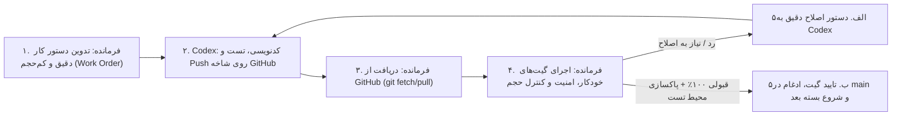

# منشور فرماندهی و نقشه راه جامع اجرای پروژه RelayForge (Web SaaS v2.0)

**نسخه سند:** `1.0.0-COMMANDER-CHARTER`  
**تاریخ تصویب:** ۲۶ نوامبر ۲۰۲۶  
**معماری مرجع:** [00_ARCHITECTURE_INDEX.md](RelayForge_Architecture/00_ARCHITECTURE_INDEX.md) | [database_schema.sql](RelayForge_Architecture/contracts/database_schema.sql) | [openapi.yaml](RelayForge_Architecture/contracts/openapi.yaml)  
**وضعیت فعلی پروژه:** معماری ۶۵ فایلی و قراردادهای ماشینی تکمیل و صحت‌سنجی شده — آماده شروع گام‌به‌گام کدنویسی توسط Codex روی GitHub.

---

## ۱. تفاهم‌نامه عملیاتی و ساختار فرماندهی چندمدلی (Multi-Model Governance Charter)

بر اساس دستور مالک پروژه، مدل حکمرانی و تقسیم کار در تمام طول ساخت محصول به شرح زیر قفل می‌شود:

### ۱.۱ نقش‌ها و مرز مسئولیت‌ها

| نقش | عامل هوش مصنوعی / ابزار | شرح دقیق وظایف و حدود اختیارات |
|---|---|---|
| **فرمانده پروژه و دروازه‌بان کیفیت (`Project Commander & Gatekeeper`)** | **Antigravity (من)** | اتخاذ تمامی تصمیمات فنی و معماری؛ شکستن پروژه به بسته‌های کاری اتمیک و دقیق (`Work Orders`)؛ صدور دستور مهندسی حساب‌شده برای Codex؛ دریافت کد از GitHub (`git fetch/pull`)؛ اجرای تست‌ها، بررسی امنیت، انطباق با اسکیمای ۵۱ جدولی و کنترل حجم؛ رد کردن کدهای معیوب یا حجیم و صدور مجوز عبور از هر گیت (`Sign-off`). |
| **مجری انحصاری کدنویسی (`Primary Code Author`)** | **Codex (متصل به GitHub)** | نوشتن ۱۰۰٪ کدهای تولیدی و تست‌های پروژه در شاخه‌های مشخص‌شده و Push مستقیم به مخزن GitHub. فرمانده رأساً کد محصول را در مخزن نمی‌نویسد تا تفکیک کامل بین «نویسنده کد» و «ممیز/فرمانده» حفظ شود. |
| **مشاوران بازبینی موازی و موارد لبه (`Targeted Reviewers`)** | **Qwen / GLM** | استفاده **فقط در صورت نیاز واقعی** (مانند بازبینی مستقل منطق پیچیده پردازش متن فارسی/AST، استخراج سناریوهای تست لبه یا مقایسه دو راه‌حل الگوریتمی) بدون تحمیل تأخیر به مسیر اصلی. |
| **ممیز ارشد گلوگاه‌های فوق‌حساس (`Critical Escalation Reviewer`)** | **Claude** | استفاده **بسیار محدود و مقتصدانه**، صرفاً در نقاط بحرانی امنیتی یا همزمانی (مانند ممیزی نهایی رمزنگاری پاکتی خزانه، سندباکس بدون شبکه `media-worker` و منطق آشتی تحویل `UNCERTAIN` پیش از بهره‌برداری). |
| **مالک پروژه (`Product Owner`)** | **شما** | نظارت کلان بدون درگیری در جزئیات فنی روزمره؛ ورود صرفاً در **۵ خط قرمز حساس** زیر. |

### ۱.۲ خط قرمزهای ارجاع به مالک (تنها مواردی که از شما سؤال می‌شود)

فرمانده تمام تصمیمات طراحی، کتابخانه‌ها، ساختار کد، تست‌ها و رفع باگ‌ها را رأساً می‌گیرد و **فقط** در ۵ حالت زیر کار را متوقف کرده و از شما تأیید می‌گیرد:
1. **دسترسی و زیرساخت پایه:** معرفی آدرس مخزن GitHub اولیه یا نیاز به دسترسی سرور هدف `Ubuntu 24.04 LTS`.
2. **تعهد مالی یا مجوز حقوقی:** هر تصمیمی که هزینه دلاری/ریالی واقعی ایجاد کند یا مجوز نرم‌افزاری خارج از لیست مجاز (`MIT / BSD / Apache-2.0 / PostgreSQL`) بطلبد.
3. **کلیدها و حساب‌های واقعی (`Secrets & Live Channels`):** زمان اجرای آزمون زنده نهایی (`AT-22`) که نیازمند توکن بات آزمایشی یا کلید API واقعی شماست.
4. **انتشار بیرونی یا عملیات مخرب روی محیط عملیاتی:** استقرار نهایی روی دامنه عمومی یا پاکسازی داده محیط واقعی.
5. **تغییر دامنه محصول:** اگر محدودیتی بیرونی در API یکی از پیام‌رسان‌ها کشف شود که نیازمند تغییر رفتار محصول نسبت به PRD باشد.

### ۱.۳ چرخه استاندارد اجرای هر بسته کاری (`Atomic Work-Order Loop`)

---

## ۲. سیاست سخت‌گیرانه ضدتورم حجم، ایمیج و فایل (`Zero-Bloat Hygiene Policy`)

برای جلوگیری کامل از سنگین شدن پروژه، دیسک و Docker، قوانین زیر در **تمامی دستورات ارسالی به Codex** و **تمامی تست‌های فرمانده** اجباری است:

1. **معماری ایمیج مشترک و فوق‌سبک Docker (حداکثر ۲ ایمیج ساخته‌شده در کل پروژه):**
   - **ایمیج ۱ (`relayforge-app`):** یک ایمیج واحد چندمرحله‌ای (`Multi-stage python:3.12-slim` یا پایه کش‌شده محلی بدون کامپایلرهای اضافه) که هر سه سرویس `web-api`، `dispatcher-worker` و `ingestor-worker` دقیقاً از **همان یک ایمیج مشترک** با دستور شروع (`command`) متفاوت اجرا می‌شوند (جلوگیری از ۳ برابر شدن حجم ایمیج‌ها).
   - **ایمیج ۲ (`relayforge-media`):** یک ایمیج ایزوله بر پایه `alpine` حاوی `ffmpeg`، `harfbuzz/pillow` و دیمن سبک سوکت یونیکس بدون هیچ فریم‌ورک وب یا درایور دیتابیس.
   - سرویس‌های زیرساختی (`postgres:16-alpine`، `pgbouncer` و `seaweedfs`) بدون بیلد سفارشی سنگین و با تگ نسخه ثابت و سبک استفاده می‌شوند.
2. **قوانین پاکسازی فوری پس از هر تست فرمانده:**
   - بلافاصله پس از پایان تست هر مرحله، کانتینرها و والیوم‌های موقت همان تست با `docker compose -p rf_verify down -v --remove-orphans` جمع‌آوری شده و لایه‌های بی‌استفاده (`docker image prune -f`) پاک می‌شوند.
   - **حفاظت مطلق از سایر پروژه‌های میزبان:** هیچ دستوری هرگز اجازه استفاده از `docker system prune -a` سراسری یا دست زدن به کانتینرهای غیرمرتبط سیستم شما (مانند `hamicard_*` و غیره) را ندارد؛ تمام منابع تست با پیشوند ایزوله `rf_` نام‌گذاری و پاکسازی می‌شوند.
3. **قوانین ضدتورم مخزن Git (`.gitignore` و `.dockerignore` آهنین):**
   - ممنوعیت مطلق کامیت کردن پوشه‌های `.venv`، `node_modules`، `__pycache__`، `.pytest_cache`، `.ruff_cache`، فایل‌های `.zip`، فایل‌های رسانه نمونه حجیم، خروجی‌های بیلد فرانت‌اند یا لاگ‌ها در Git.
   - تولید динамиک فایل‌های تست (عکس/صوت/JSON نمونه) در حافظه موقت حین اجرای تست و حذف خودکار در پایان تست (صفر فایل باینری حجیم داخل مخزن).
   - سقف بودجه حجم کل سورس مخزن Git (کد + اسناد معماری): **زیر ۱۵ مگابایت**.

> **گزارش پاکسازی انجام‌شده همین لحظه:** پیش از تدوین این نقشه راه، هر ۵ ایمیج موقت آزمایشگاه فاز صفر (`g0-spike-*` و `garage`)، پوشه کش `.ruff_cache` و فایل تکراری `.zip` پاکسازی شدند و کل پوشه کاری فعلی روی دیسک شما صرفاً **`740 کیلوبایت`** حجم دارد.

---

## ۳. تصمیمات قفل‌شده فرمانده برای شروع پیاده‌سازی (`DEC-01` تا `DEC-04`)

با توجه به تفویض اختیار شما، ۴ تصمیم باز فصل ۲۴ معماری بر اساس کم‌ریسک‌ترین و استانداردترین گزینه مهندسی قفل شدند:

1. **`DEC-01` (مخزن شیء S3):** انتخاب قطعی **`SeaweedFS` (`Apache-2.0` در حالت `-s3`)** جهت صفر نگه داشتن وابستگی به مجوز `AGPL-3.0` در پشته اصلی و حذف کامل `MinIO`.
2. **`DEC-02` (اهداف بازیابی و نگهداری پشتیبان):** تنظیم **`RPO <= 5 دقیقه`** (آرشیو پیوسته WAL)، **`RTO <= 30 دقیقه`** و دوره نگهداری پشتیبان فیزیکی رمزنگاری‌شده **`14 روز`** با افشای صریح در متن حریم خصوصی مستأجر جهت سازگاری حقوقی و فنی با `Crypto-Shredding`.
3. **`DEC-03` (سقف پیش‌فرض پلن پایلوت `OPERATOR_PLAN`):** سقف پیش‌فرض روزانه **`2,000,000` میکرو-دلار (\$2/روز)** و ماهانه **`30,000,000` میکرو-دلار (\$30/ماه)** برای هر مستأجر پایلوت، قابل ویرایش انحصاری توسط نقش `relayforge_operator` (`OC-01`).
4. **`DEC-04` (موج اول پیام‌رسان‌ها):** پیاده‌سازی کامل عملیاتی برای **`Telegram` (Bot API + S3 Export)**، **`Bale`** و **`Eitaa`** در موج اول، و پیاده‌سازی آداپتورهای اتاق تمیز **`Rubika v3`** و **`Soroush Plus`** پشت پرچم صریح `EXPERIMENTAL` تا زمان اجرای کاوش زنده نهایی (`AT-22`).

---

## ۴. نقشه راه کامل مهندسی پروژه (۸ فاز `M0..M7` و ۲۴ بسته کاری Codex)

هیچ بسته کاری جدیدی به Codex ابلاغ نمی‌شود مگر آنکه بسته قبلی از GitHub دریافت و تمامی معیارهای قبولی آن توسط فرمانده تأیید شده باشد.

### نمای کلی فازها

| فاز | عنوان فاز | بسته‌های کاری Codex | ماژول‌های معماری | خروجی کلیدی و شرط ممیزی بسته‌شده |
|---|---|---|---|---|
| **`M0`** | اسکلت مخزن Greenfield، اسکیمای ۵۱ جدولی و گیت‌های CI | `WO-01` .. `WO-02` | پایه کل سیستم | اجرای خودکار `database_schema.sql`، گیت‌های `SPK-06`، `OC-01`, `OC-06`, `OC-10` |
| **`M1`** | هسته چندمستأجری، احراز هویت، خزانه پاکتی و امنیت شبکه | `WO-03` .. `WO-05` | `M01`, `M02` | ورود `Argon2id`، `TenantRLSMiddleware`، خزانه `Tenant DEK`، `SafeDialer`، بخش اول `OC-03` |
| **`M2`** | اتصال پیام‌رسان‌ها، آپلود/پارس جریانی S3 و محتوای استاندارد | `WO-06` .. `WO-08` | `M03`, `M04` | آداپتورهای پیام‌رسان، `SeaweedFS` + `ijson` با نگهبان ورودی خصمانه (**بستن `OC-04`**)، `UTF-16 AST` |
| **`M3`** | موتور قوانین، پیش‌نویس، صف تحویل ضدسقوط و آشتی `UNCERTAIN` | `WO-09` .. `WO-11` | `M09` (هسته) | مسیر `Copy/Rules` بدون AI، صف Water-Filling، تست `SIGKILL` واقعی کارگر (**بستن `OC-02`**) |
| **`M4`** | درگاه هوش مصنوعی، بودجه دوسطحی، کانال‌شناس و استودیو متن | `WO-12` .. `WO-15` | `M05`, `M06`, `M07` | BYOK (`OpenAI/Gemini`)، بودجه اتمیک، تحلیل کانال، هویت برند، ۴ حالت آزادی و `Fact Guard` فارسی |
| **`M5`** | استودیو رسانه، پادکست، سندباکس `media-worker` و انتشار خودکار | `WO-16` .. `WO-18` | `M08`, `M09` (پیشرفته) | کانتینر بدون شبکه `media-worker` (`AF_UNIX`)، اینفوگرافیک فارسی، کلیپ، پادکست و دروازه ریسک خودکار |
| **`M6`** | رابط کاربری وب فارسی RTL، گزارش‌گیری، ممیزی و پشتیبان `PITR` | `WO-19` .. `WO-21` | `UI`, `M10` | پنل وب ۱۳ صفحه‌ای RTL سبک، ممیزی تغییرناپذیر، بسته پشتیبان `Safe Mode` و `pgBackRest` (**بستن `OC-03`**) |
| **`M7`** | سخت‌سازی امنیتی، بنچمارک بار ترکیبی و تحویل `Ubuntu 24.04` | `WO-22` .. `WO-24` | کل سیستم | تست نفوذ `AT-20`، بار ترکیبی ۵۰ مستأجر (**بستن `OC-07`**)، پذیرش بومی لینوکس (**بستن `OC-08`**) و `AT-22` |

---

### جزئیات اجرایی ۲۴ بسته کاری (`Work Orders`) برای ابلاغ ترتیبی به Codex

#### فاز `M0` — زیرساخت مخزن، دیتابیس ۵۱ جدولی و سپر CI
- **`WO-01` (اسکلت مخزن سبک و پیکربندی ضدتورم):**
  - ایجاد ساختار ماژولار `src/relayforge/{core,adapters,workers,web}`، `ui/`، `deploy/`، فایل‌های `.gitignore` و `.dockerignore` سخت‌گیرانه، `pyproject.toml` با وابستگی‌های قفل‌شده کم‌حجم، تنظیمات `ruff.toml` (شامل منع کامل `transaction.on_commit` مستقیم — `OC-06`) و `.importlinter` (منع واردات معکوس لایه‌ها — `SPK-06`).
  - منتقل کردن پوشه مرجع `RelayForge_Architecture/` به داخل مخزن به‌عنوان قرارداد رسمی طراحی.
- **`WO-02` (مهاجرت پایه PostgreSQL 16 و سوئیت دودکش دیتابیس):**
  - سیم‌کشی کانتینر مهاجرت (`relayforge_migrator`) برای اجرای اتمیک `contracts/database_schema.sql` (۵۱ جدول) همراه با اسکریپت تست CI که روی `postgres:16-alpine` اثبات کند: `51/51 FORCE RLS` فعال است، صفر نقش غیر-superuser دارای `BYPASSRLS` است (`OC-10`) و تمام ۱۸ حکم امنیتی و ۴ تست جهش `g0_spike_smoke_test.sql` (`v1.3.2` شامل `OC-01`) سبز می‌شوند.

#### فاز `M1` — هسته چندمستأجری، خزانه اسرار و مرزهای امنیتی (`M01, M02`)
- **`WO-03` (احراز هویت وب، نشست سرورمحور و میان‌افزار اتمیک RLS):**
  - پیاده‌سازی ثبت/ورود با `Argon2id`، کوکی `__Host-rf_session` (`HttpOnly`, `Secure`, `SameSite=Lax`)، محافظت `X-CSRFToken` و بررسی `Origin`، تنظیمات دیتابیس جنگو برای `PgBouncer` تراکنشی (`CONN_MAX_AGE = 0`, `DISABLE_SERVER_SIDE_CURSORS = True`, `prepare_threshold = None` — `OC-05`)، میان‌افزار اتمیک `TenantRLSMiddleware` (`SET LOCAL app.tenant_id`) و تابع امن `on_tenant_commit`.
  - تست قبولی: ۱۰۰ درخواست موازی بین دو مستأجر با صفر نشت خواندن/نوشتن (`AT-01`, `AT-18`, `SEC-09`).
- **`WO-04` (خزانه پاکتی `Tenant DEK`، رضایت خارجی و حذف قطعی رمزنگاری):**
  - پیاده‌سازی `EnvelopeSecretVault` (`Master KEK` + کلید اختصاصی هر مستأجر در `app.tenant_encryption_keys` با `AES-256-GCM`)، مدیریت رضایت‌های تفکیک‌شده خارجی (`external_consents` — `SEC-10`)، API اپراتور برای مدیریت سقف پلن `OPERATOR_PLAN` (`OperatorBearerAuth`) و گردش‌کار حذف حساب با صفر کردن کلید مستأجر (`Crypto-Shredding` — بخش اول `OC-03`).
- **`WO-05` (کلاینت شبکه ضد-SSRF و لایه سانسورگر سرتاسری اسرار):**
  - پیاده‌سازی `SafeDialer` (ارزیابی IP پس از DNS در لحظه اتصال سوکت، مسدودسازی رنج‌های خصوصی/Loopback/Metadata و بازبینی هر گام Redirect — `SEC-06`) و `SecretScrubbingTransport` + فیلتر لاگ ساختاریافته که هرگز اجازه نشت توکن بات یا کلید API در استثناها، لاگ‌ها و پاسخ‌های API را ندهد (`DST-08`, `SEC-03`).

#### فاز `M2` — پیام‌رسان‌ها، استخراج جریانی S3 و محتوای استاندارد (`M03, M04`)
- **`WO-06` (پورت‌های پیام‌رسان و آداپتورهای تلگرام، بله، ایتا و اسکلت آزمایشی روبیکا/سروش):**
  - پیاده‌سازی `TelegramBotAdapter` (دریافت زنده با تشخیص `409 Conflict`، ارسال متن/رسانه/آلبوم/استیکر/ویس، رعایت `has_protected_content`)، `BaleBotAdapter`، `EitaayarAdapter` (همراه با تفکیک دقیق `test-connection` از `test-publish` — `DST-02` و پیش‌فرض `NEW_ONLY` — `DST-04`) و آداپتورهای اتاق تمیز `RubikaV3Adapter` و `SoroushPlusCleanRoomAdapter` (صفر خط کد GPLv3) پشت پرچم `EXPERIMENTAL`.
- **`WO-07` (آپلود مستقیم S3 به `SeaweedFS`، پارس جریانی `ijson` و بستن کامل `OC-04`):**
  - پیاده‌سازی صدور فرم S3v4 POST مقید به پیشوند مستأجر (`tenants/<tid>/exports/` + فیلد صریح `bucket` + `content-length-range`)، قانون حذف خودکار ۲۴ ساعته (`S3 Lifecycle`)، خواننده جریانی `S3ExportStreamIngestor` با `ijson (yajl2_c)` و **نگهبان عمق و طول توکن پیش از پارسر** در برابر JSON خصمانه، فایل بیش از سقف و ثبت ادامه دقیق از نقطه توقف (`source_cursors`).
  - تست قبولی: رد آپلود خارج از پیشوند و بیش از سقف حجم، دفع JSON خصمانه/عمیق بدون کرش و ثبت `delta RSS <= 128 MiB` (**بستن کامل شرط `OC-04`** و `AT-02`).
- **`WO-08` (مدل `CanonicalRichText` با اندیس `UTF-16`، کامپایلرهای مقصد و قالب امن `{body}`):**
  - نرمال‌ساز `NFC` با حفظ نیم‌فاصله (`ZWNJ`) و ایموجی‌های ترکیبی، محاسبه دقیق بازه‌های `UTF-16`، کامپایلرهای اختصاصی تلگرام/بله/ایتا/روبیکا (سقف ۳۰ بخش متادیتا) به همراه گزارش افت قالب (`FMT-01..08`)، موتور قالب‌ساز بدون اجرای کد با شرط دقیق یک `{body}` (`style_package.schema.json`) و جست‌وجوی متن کامل در PostgreSQL (`GIN tsvector`).
  - تست قبولی: آزمون‌های Property-based فارسی و ایموجی (`AT-04`) و دفع تزریق قالب (`AT-20`).

#### فاز `M3` — موتور قوانین، پیش‌نویس، صف تحویل ضدسقوط و آشتی (`M09` پایه)
- **`WO-09` (موتور فیلتر، تبدیل قطعی، تشخیص تکرار و شبیه‌ساز `Dry-Run`):**
  - پیاده‌سازی درخت شرطی `AND/OR/NOT` با سقف عمق، موتور عبارات باقاعده خطی (`google-re2` علیه `ReDoS` — `RULE-09`)، تشخیص دور در گراف مسیرها (`Cycle Detection` — `RULE-06`)، تشخیص تکرار دقیق و شباهت مرزی (`SHA-256` + `SimHash-64` — `RULE-05`) و شبیه‌ساز کامل `Dry-Run` با قطع فیزیکی خروجی شبکه (`RULE-07`).
- **`WO-10` (چرخه پیش‌نویس، نسخه‌های منجمد انتشار، زمان‌بندی تقویمی و مسیر بدون AI):**
  - پیاده‌سازی ویرایشگر نسخه‌دار `drafts / draft_revisions`، انجماد تغییرناپذیر `publication_versions` هنگام تأیید انتشار (`explicit_user_confirmation=true` — `PUB-05`)، زمان‌بندی تقویمی آگاه از Timezone، سیاست عقب‌افتادگی پس از خاموشی (`HOLD_FOR_REVIEW` پیش‌فرض — `QUE-03`) و اجرای کامل مسیرهای سنتی `COPY` و `RULES` در حالت خاموشی ۱۰۰٪ هوش مصنوعی (`AT-03`).
- **`WO-11` (کارگر توزیع منصفانه Water-Filling، چرخه `UNCERTAIN` و بستن کامل `OC-02`):**
  - پیاده‌سازی کارگر `dispatcher-worker` متصل به توابع دیتابیس (`fn_worker_claim_next_jobs`, `fn_worker_heartbeat`, `fn_worker_complete_delivery`, `fn_reap_expired_delivery_leases`) با توکن حصارکشی `lease_epoch`، طبقه‌بندی ۶گانه خطا و احترام به `Retry-After` (`QUE-06, QUE-07`)، صف آشتی ممیزی‌شده `UNCERTAIN` (`reconciliation_records` — `QUE-08`) و کلید توقف اضطراری سراسری (`QUE-10`).
  - تست قبولی: اجرای سوئیت یکپارچه‌سازی با اسپاون زیرپروسه واقعی کارگر و ارسال سیگنال **`os.kill(pid, signal.SIGKILL)`** واقعی سیستم‌عامل در هر ۵ نقطه حساس تحویل و اثبات صفر ارسال تکراری و انتقال دقیق به `UNCERTAIN / READY` (**بستن کامل شرط `OC-02`**، `AT-14`, `AT-16`).

#### فاز `M4` — درگاه هوش مصنوعی، بودجه دوسطحی، کانال‌شناس و استودیو تولید متن (`M05, M06, M07`)
- **`WO-12` (درگاه هوش مصنوعی BYOK، کش مدل‌ها، مسیریاب و دفتر کل بودجه دوسطحی):**
  - پیاده‌سازی آداپتورهای `OpenAI`, `Gemini` و `LocalOpenAiCompat` با جداسازی قابلیت‌ها (`TEXT, VISION, IMAGE, SPEECH_TTS, VIDEO`)، کش مدل با اثر انگشت `HMAC-SHA256` کلید (`AT-10`)، مسیریاب `WEAK_TO_STRONG / STRONG_TO_WEAK` با اعتبارسنجی سخت JSON Schema، عدم چرخش کلید روی `429 QUOTA_ZERO` (`AT-11`) و اتصال به توابع اتمیک بودجه (`fn_budget_reserve` / `fn_budget_settle` با تفکیک `ACTUAL / ESTIMATED / UNKNOWN`).
- **`WO-13` (کانال‌شناس آماری/هوشمند، جداسازی هویت برند و کتابخانه سبک):**
  - پیاده‌سازی نمونه‌گیری پراکنده (`SAMPLING_ONLY` با مسدودیت ساختاری ورود به صف انتشار — `AT-05`)، تحلیل آماری آفلاین ۸۰/۲۰ + خوشه‌بندی چندالگویی، استخراج جداگانه هویت کانال با پیش‌فرض حذف هویت ثالث (`STRIP_BY_DEFAULT`)، تزریق قطعی الگوریتمی هویت برند مقصد پس از تولید (`BrandInjector` — `AT-09`)، کتابخانه نسخه‌دار سبک، خروجی/ورودی امن بدون اسرار و ترکیب وزنی سبک‌ها (`AT-06`).
- **`WO-14` (استودیو تولید محتوا، ۴ حالت آزادی و نرمال‌ساز حقایق فارسی `Fact Guard`):**
  - پیاده‌سازی سرویس تولید و بازنویسی محتوا با جداسازی پیام سیستم دارای Nonce تصادفی و صفر دسترسی Tool برای مدل (`SEC-08, SEC-15`)، پیاده‌سازی دقیق قرارداد ۴ حالت آزادی (شامل خاموشی مطلق `Fact Guard` در حالت `FULLY_FREE` — `AT-07`)، نرمال‌ساز قطعی اعداد، قیمت‌ها و واحدها به فارسی/لاتین (`۲۵۰ هزار تومان == 250,000 تومان` — `AT-08`)، تشخیص ادعاهای حساس پزشکی/مالی و کارت ارزیابی سه‌بخشی واقعی (`GEN-07..12`).
- **`WO-15` (یادگیری ترجیحات بازگشت‌پذیر و مقید به برند):**
  - پیاده‌سازی ثبت اختیاری اصلاحات کاربر صرفاً با رضایت فعال، استخراج قاعده پیشنهادی با حداقل نصاب شواهد (`evidence_count >= 3`)، عایق‌بندی کامل حافظه سبک بین پروژه‌ها و برندها و قابلیت بازنشانی و حذف فیزیکی فوری (`AT-17`).

#### فاز `M5` — استودیو رسانه، پادکست، سندباکس `media-worker` و انتشار خودکار (`M08, M09`)
- **`WO-16` (کانتینر ایزوله بدون شبکه `media-worker`، کتابخانه رسانه و جست‌وجوی عکس مجاز):**
  - پیاده‌سازی دیمن `media-worker` روی سوکت یونیکس (`AF_UNIX`) با سهمیه سخت CPU/RAM/PID، بدون کارت شبکه (`network_mode: none`)، بررسی Magic Bytes و سقف ۴۰ مگاپیکسل تصویر، پاکسازی قطعی پوشه موقت، شمارش ارجاعات فعال پیش از حذف (`media_asset_refs`) و آداپتور جست‌وجو و دانلود امن عکس/کلیپ دارای مجوز (`Pexels` با کمینه‌سازی کوئری و ثبت انتساب — `AT-13`).
- **`WO-17` (تولید تصویر AI، اینفوگرافیک فارسی قطعی، استیکر، کلیپ `FFmpeg` و پادکست TTS):**
  - پیاده‌سازی کارهای ناهمگام تولید/ویرایش تصویر AI و ویدئوی مولد با پیش‌برآورد و رزرو بودجه، موتور رندر قطعی اینفوگرافیک فارسی با شکل‌دهی صحیح حروف و ارقام فارسی (`HarfBuzz`)، مبدل استیکر بومی (`512x512 WebP < 512KB`)، سازنده کلیپ محلی `FFmpeg` و خط لوله سناریونویسی + سنتز پادکست تک/دوگوینده با کش قطعه‌ای دیالوگ‌ها (`AUD-01..05`, `AT-12`).
- **`WO-18` (ارکستراتور انتشار خودکار و دروازه ریسک `AutoPublishRiskGate`):**
  - پیاده‌سازی سه سطح خودکارسازی (`DRAFT_ONLY` پیش‌فرض، `APPROVAL_REQUIRED`, `AUTO_PUBLISH_BY_POLICY`)، دروازه ریسک چندعاملی (توقف خودکار در صورت مغایرت `Fact Guard`، ادعای حساس یا کمبود مجوز رسانه)، ۵ سیاست Fallback صریح هنگام خرابی AI و کنترل سقف روزانه پست و ساعات مجاز (`AT-15`).

#### فاز `M6` — رابط کاربری وب فارسی RTL، گزارش‌گیری، ممیزی و پشتیبان‌گیری (`UI, M10`)
- **`WO-19` (اسکلت رابط کاربری وب فارسی RTL و صفحات عملیات، اتصالات و مسیرها):**
  - پیاده‌سازی فرانت‌اند وب سبک، واکنش‌گرا و بومی RTL فارسی با تایپوگرافی استاندارد فارسی، ناوبری شفاف فضای کاری، داشبورد شمارنده‌های واقعی، مدیریت مبدأ/مقصدها با تفکیک تست اتصال و تست انتشار، سازنده بصری قوانین و شبیه‌ساز `Dry-Run`، و بروزرسانی زنده بدون حالت از طریق `/events/poll`.
- **`WO-20` (صفحات کانال‌شناس، کتابخانه سبک، استودیو تولید متن/رسانه/پادکست و صف آشتی):**
  - تکمیل صفحات تحلیلی کانال‌شناس، ویرایشگر دوسطحی اصل/کاندید با نمایش هایلایت اختلافات `Fact Guard`، استودیو رسانه و پادکست، پیش‌نمایش تفکیک‌شده هر پیام‌رسان، دیالوگ تأیید صریح انتشار نهایی در برابر ارسال آزمایشی و میز کار رسیدگی به وضعیت‌های `UNCERTAIN`.
- **`WO-21` (گزارش‌گیری امن، ممیزی تغییرناپذیر، بسته پشتیبان مستأجر و بستن کامل `OC-03`):**
  - پیاده‌سازی خروجی گزارش `CSV/JSON` مقاوم در برابر Formula Injection و بدون اسرار، مرکز اعلان بدون اسپم تکراری، خروجی/بازیابی بسته منطقی مستأجر (`Argon2id + AES-256-GCM`) با بازپیچانی کلیدها در حافظه و ورود اجباری به `Safe Mode` (`AT-19`)، به همراه پیکربندی اسکریپت‌های عملیاتی `pgBackRest` (`AES-256-CBC + HMAC-SHA256` روی Base + WAL) و اجرای تست کامل بازیابی `PITR` با ثبت زمان واقعی `RTO` (**بستن کامل شرط `OC-03`**).

#### فاز `M7` — سخت‌سازی امنیتی، بنچمارک بار ترکیبی و تحویل پایلوت روی `Ubuntu 24.04`
- **`WO-22` (مجموعه تست نفوذ خودکار ۱۷ بردار تهدید و E2E مرورگر):**
  - پیاده‌سازی سوئیت کامل امنیت خودکار (`AT-20`: دفع XSS، CSRF، SSRF با Redirect، Prompt Injection، Path Traversal، بمب آرشیو/تصویر، ReDoS و تلاش عبور از RLS یا سقف بودجه پلن) و تست‌های سرتاسری کلیدی مرورگر (`AT-01`, `AT-21`). *(نقطه فراخوانی هدفمند ممیزی امنیتی با `Claude` در صورت نیاز).*
- **`WO-23` (بنچمارک بار ترکیبی ۵۰ مستأجر همزمان و بستن کامل `OC-07`):**
  - اجرای آزمون بار همزمان ۵۰ مستأجر روی `web-api` و `dispatcher-worker` در حالی که `media-worker` تحت فشار فعال رندر `FFmpeg` قرار دارد، تنظیم نهایی محدودیت‌های `cpus` و `mem_limit` در `deploy/docker-compose.prod.yml` و اثبات `p99 <= 500 ms` با صفر خطای استخر اتصال (**بستن کامل شرط `OC-07`**).
- **`WO-24` (بسته استقرار `Ubuntu 24.04 LTS`، پذیرش بومی لینوکس `OC-08` و کاوش زنده `AT-22`):**
  - نهایی‌سازی واحد سرویس `systemd`، قوانین فایروال `ufw`، پیکربندی TLS معکوس (`Caddy/Nginx`)، اسکن زنجیره تأمین (`pip-audit`, `gitleaks`, بررسی مجوزها — `SEC-13`)، اجرای چک‌لیست پذیرش روی محیط بومی `Ubuntu 24.04 LTS` (**بستن کامل شرط `OC-08`**) و اجرای ابزار کاوشگر زنده قابلیت‌ها (`AT-22`) روی کانال‌های تست مجاز مالک.

---

## ۵. ماتریس نهایی بستن تمام شرایط ممیزی فاز صفر (`OC-01` تا `OC-10`)

| کد شرط | وضعیت فعلی | محل بستن قطعی در نقشه راه |
|---|---|---|
| `OC-01` (تفکیک سقف پلن اپراتور از مستأجر) | **بسته‌شده در SQL (`v1.3.2`)** | تثبیت در CI بسته `WO-02` + پنل اپراتور در `WO-04` |
| `OC-02` (تست `SIGKILL` واقعی پروسه کارگر) | باز (`PARTIAL`) | **بسته‌شدن قطعی در `WO-11` (فاز `M3`)** |
| `OC-03` (رمزنگاری احرازشده WAL + ثبت `RTO` + `Crypto-Shredding`) | باز (`PARTIAL`) | **بسته‌شدن قطعی در `WO-04` و `WO-21` (فاز `M1` و `M6`)** |
| `OC-04` (ورودی JSON خصمانه، سقف آپلود و Lifecycle باکت S3) | باز (`PARTIAL`) | **بسته‌شدن قطعی در `WO-07` (فاز `M2`)** |
| `OC-05` (`prepare_threshold=None` در PgBouncer تراکنشی) | **بسته‌شده در معماری** | پیاده‌سازی و تست همزمانی در `WO-03` (فاز `M1`) |
| `OC-06` (ثبت کامل متادیتای شواهد و منع دور زدن گیت `on_commit`) | **بسته‌شده در معماری** | قفل شدن در CI بسته `WO-01` و `WO-02` (فاز `M0`) |
| `OC-07` (آزمون بار ۵۰ مستأجر همزمان با فشار CPU در `media-worker`) | باز (`PARTIAL`) | **بسته‌شدن قطعی در `WO-23` (فاز `M7`)** |
| `OC-08` (تکرار تست‌های هسته و سندباکس روی کرنل بومی `Ubuntu 24.04`) | باز (`PENDING HOST`) | **بسته‌شدن قطعی در `WO-24` (فاز `M7`)** |
| `OC-09` (استفاده از `SeaweedFS Apache-2.0` و حذف `MinIO`) | **بسته‌شده (`DEC-01`)** | پیاده‌سازی مستقیم با `SeaweedFS` در `WO-07` (فاز `M2`) |
| `OC-10` (ممیزی کاتالوگ `0 BYPASSRLS` روی نقش‌های برنامه) | **بسته‌شده (`EXECUTED`)** | گیت خودکار همیشگی در `WO-02` (فاز `M0`) |

---

## ۶. پیش‌نیاز شروع فوری فاز `M0` (`WO-01`)

برای آنکه اولین دستور کار مهندسی (`WO-01`) را صادر کنم تا **Codex** کدنویسی را آغاز کرده و داخل GitHub پوش کند و من از GitHub دریافت و راستی‌آزمایی کنم، فقط یک مورد زیر را مشخص بفرمایید:

- **آدرس مخزن GitHub پروژه چیست؟** (اگر هنوز مخزن خالی نساخته‌اید یا می‌خواهید نام مشخصی داشته باشد، لینک مخزن GitHub متصل به Codex خود را بدهید تا پوشه فعلی را به همان مخزن متصل کنم و بلافاصله بسته کاری `WO-01` را کلید بزنیم.)
